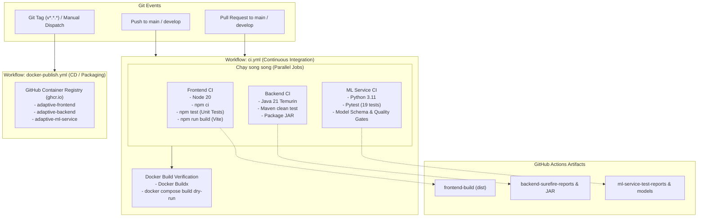

# HƯỚNG DẪN CI/CD PIPELINE VỚI GITHUB ACTIONS
## Hệ Thống Gợi Ý Lộ Trình Học Tập & Phân Loại Trình Độ Sinh Viên (Adaptive Learning System)

> **Tác giả:** DevOps & MLOps Team  
> **Phiên bản:** 1.0.0  
> **CI Workflows:** `.github/workflows/ci.yml` & `.github/workflows/docker-publish.yml`

---

## 1. TỔNG QUAN HỆ THỐNG CI/CD

Quy trình CI/CD được thiết lập nhằm tự động hóa quá trình kiểm thử, kiểm định chất lượng mô hình máy học (ML Model Governance), đóng gói ứng dụng và phát hành container image.



---

## 2. CHI TIẾT CÁC WORKFLOWS

### 2.1. Workflow 1: Continuous Integration (`.github/workflows/ci.yml`)

- **Kích hoạt khi:** 
  - `push` vào các nhánh `main` hoặc `develop`.
  - `pull_request` tạo về các nhánh `main` hoặc `develop`.
- **Cơ chế Concurrency:** `cancel-in-progress: true` tự động hủy lượt chạy cũ nếu có commit mới được đẩy lên cùng nhánh.

#### Job 1: `frontend` (React + Vite)
- **Môi trường:** `ubuntu-latest`, Node.js 20.
- **Cache:** Tận dụng `cache: 'npm'` dựa trên `frontend/package-lock.json`.
- **Các bước thực thi:**
  1. `npm ci`: Cài đặt chính xác các phụ thuộc.
  2. `npm test`: Kiểm tra cấu hình dự án, cấu trúc DOM root và tính toàn vẹn của dữ liệu mẫu (`test/frontend.test.js`).
  3. `npm run build`: Đóng gói assets tối ưu vào thư mục `dist`.
- **Artifact:** Lưu trữ thư mục `frontend/dist` với tên `frontend-build` (lưu 7 ngày).

#### Job 2: `backend` (Spring Boot 3 + Java 21)
- **Môi trường:** `ubuntu-latest`, JDK 21 (Eclipse Temurin).
- **Cache:** Tận dụng `cache: 'maven'` lưu `.m2/repository`.
- **Các bước thực thi:**
  1. `chmod +x mvnw`
  2. `./mvnw clean test package -B`: Chạy 14 bài kiểm thử tích hợp (Spring Data JPA, H2 In-Memory DB, Controllers, Security, Rule-Based Recommendation Services) và đóng gói `adaptive-learning-backend-0.0.1-SNAPSHOT.jar`.
- **Artifact:** 
  - `backend-surefire-reports`: Báo cáo chi tiết kết quả kiểm thử XML/TXT.
  - `backend-executable-jar`: File JAR thực thi độc lập.

#### Job 3: `ml-service` (FastAPI + ML Governance)
- **Môi trường:** `ubuntu-latest`, Python 3.11.
- **Cache:** Tận dụng `cache: 'pip'` dựa trên `requirements.txt`.
- **Các bước thực thi:**
  1. `pip install -r requirements.txt`
  2. `pytest --junitxml=reports/pytest-report.xml -v`: Chạy toàn bộ 19 unit tests và kịch bản **Quality Gate**:
     - Kiểm tra schema Pydantic `StudentFeatures` (ngăn dữ liệu sai dải giá trị).
     - Kiểm tra khả năng transform của `ColumnTransformer` (StandardScaler + OneHotEncoder).
     - Dự đoán trên tập **Held-out Test Set** (20% dữ liệu gốc) và kiểm tra:
       - **Accuracy $\ge$ 80%** (Decision Tree: 88.61%, XGBoost: 93.67%).
       - **Macro F1-Score $\ge$ 80%** (Decision Tree: 89.98%, XGBoost: 94.63%).
- **Artifact:** 
  - `ml-service-test-reports`: Báo cáo chuẩn JUnit XML.
  - `ml-model-artifacts`: Model files (`.joblib`, `.json`, `.png`).

#### Job 4: `docker-build-check`
- **Phụ thuộc:** Chạy sau khi cả 3 jobs trên (`frontend`, `backend`, `ml-service`) đều **PASSED**.
- **Mục đích:** Đảm bảo tất cả Dockerfile (`frontend/Dockerfile`, `backend/Dockerfile`, `ml-service/Dockerfile`) đều build thành công mà không gặp lỗi phân giải layer hay build context.

---

### 2.2. Workflow 2: Build & Publish Containers (`.github/workflows/docker-publish.yml`)

- **Kích hoạt khi:** 
  - Đẩy Git Tag dạng phiên bản: `git tag v1.0.0 && git push origin v1.0.0`.
  - Hoặc kích hoạt thủ công từ giao diện GitHub (**Actions** $\rightarrow$ **Run workflow**) với tùy chọn đặt thẻ tag và cờ `push`.
- **Đặc điểm bảo mật:**
  - Sử dụng biến bảo mật mặc định `${{ secrets.GITHUB_TOKEN }}` được cấp quyền tự động bởi GitHub Actions, **tuyệt đối không hardcode tài khoản/mật khẩu vào file YAML**.
  - Đẩy image lên **GitHub Container Registry (ghcr.io)**:
    - `ghcr.io/<owner>/adaptive-frontend:<tag>`
    - `ghcr.io/<owner>/adaptive-backend:<tag>`
    - `ghcr.io/<owner>/adaptive-ml-service:<tag>`

---

## 3. HƯỚNG DẪN KIỂM THỬ LOCAL TRƯỚC KHI PUSH

Để đảm bảo tỷ lệ vượt qua CI trên GitHub là 100%, hãy chạy script kiểm thử tự động tại local:

```powershell
powershell -ExecutionPolicy Bypass -File .\test_local_ci.ps1
```

Nếu cả 3 stages báo `[PASS]` với tỷ lệ đạt `100%`, mã nguồn hoàn toàn sẵn sàng để commit và push.

---

## 4. HƯỚNG DẪN COMMIT VÀ PUSH LÊN GITHUB

### Bước 1: Kiểm tra trạng thái Git
```bash
git status
```

### Bước 2: Thêm các file thay đổi vào staging
```bash
git add .github/workflows/
git add frontend/
git add backend/
git add ml-service/
git add test_local_ci.ps1
git add docs/ci_cd_guide.md
git add README.md
```

### Bước 3: Tạo commit với thông điệp chuẩn hóa
```bash
git commit -m "feat(ci-cd): implement GitHub Actions CI pipeline, model quality gates, and docker publish workflow"
```

### Bước 4: Đẩy lên remote repository
```bash
git push origin main
# hoặc git push origin develop
```

---

## 5. CÁCH THEO DÕI VÀ XEM KẾT QUẢ TRÊN GITHUB ACTIONS

1. Truy cập vào kho lưu trữ GitHub của bạn: `https://github.com/<owner>/adaptive-learning-system`.
2. Nhấp vào tab **Actions** trên thanh menu điều hướng.
3. Trong danh sách workflow, nhấp vào lượt chạy gần nhất mang tên commit của bạn.
4. Bạn sẽ thấy 4 jobs:
   - `Frontend (React + Vite)`
   - `Backend (Spring Boot 3 + Java 21)`
   - `ML Service (FastAPI + Scikit-learn + XGBoost)`
   - `Docker Build Verification`
5. Nhấp vào từng job để xem chi tiết log của từng bước.
6. Ở cuối trang tổng quan của lượt chạy, phần **Artifacts** sẽ cho phép tải về:
   - `frontend-build.zip`: Mã nguồn frontend đã đóng gói sẵn sàng deploy.
   - `backend-executable-jar.zip`: File JAR Spring Boot thực thi.
   - `backend-surefire-reports.zip`: Báo cáo kiểm thử JUnit backend.
   - `ml-service-test-reports.zip`: Báo cáo kiểm thử pytest.
   - `ml-model-artifacts.zip`: Bộ model weights và biểu đồ đánh giá.
