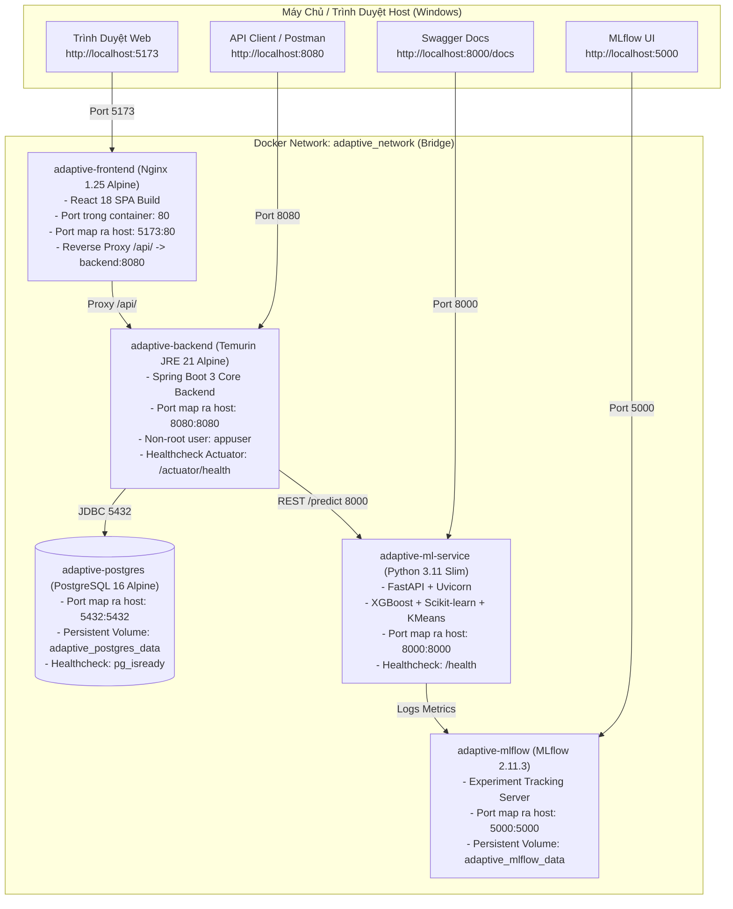

# Hướng Dẫn Vận Hành & Triển Khai Toàn Diện Với Docker (Dockerize Guide)
## Hệ Thống AI-Powered Adaptive Learning & Student Performance Prediction

---

### 1. Kiến Trúc Containerization & Network Topology

Hệ thống được thiết kế theo mô hình Microservices với 5 containers liên kết qua Docker Bridge Network riêng biệt (`adaptive_network`):



---

### 2. Danh Sách Services Trong Docker Compose

| Service | Container Name | Base Image | Port Host : Container | Persistent Volume / Mounts | Dependencies & Healthcheck |
| :--- | :--- | :--- | :---: | :--- | :--- |
| **postgres** | `adaptive-postgres` | `postgres:16-alpine` | `5432:5432` | `adaptive_postgres_data:/var/lib/postgresql/data`<br>`database/init.sql:/docker-entrypoint-initdb.d/init.sql` | `pg_isready -U adaptive_user -d adaptive_learning_db` |
| **ml-service** | `adaptive-ml-service` | `python:3.11-slim` | `8000:8000` | Code, models & data copy vào image | `curl -f http://localhost:8000/health` |
| **mlflow** | `adaptive-mlflow` | `ghcr.io/mlflow/mlflow:v2.11.3` | `5000:5000` | `adaptive_mlflow_data:/mlflow` | Khởi động server SQLite + Artifacts |
| **backend** | `adaptive-backend` | `eclipse-temurin:21-jre-alpine` | `8080:8080` | Multi-stage build từ Maven 3.9 | Phụ thuộc `postgres` (healthy) & `ml-service` (healthy) |
| **frontend** | `adaptive-frontend` | `nginx:alpine` | `5173:80` | Multi-stage build từ Node 20, Nginx proxy | Phụ thuộc `backend` (started) |

---

### 3. Hướng Dẫn Vận Hành Dành Cho Nhóm Sinh Viên

#### A. Khởi Động Toàn Bộ Hệ Thống Bằng 1 Lệnh Duy Nhất
Mở terminal PowerShell tại thư mục gốc của dự án (`adaptive-learning-system`):
```bash
docker compose up --build -d
```
> **Lưu ý:** Lần đầu chạy sẽ mất 2-3 phút để tải base images và biên dịch container. Các lần sau sẽ tận dụng Docker Cache chỉ mất vài giây.

#### B. Kiểm Tra Trạng Thái & Log Của Từng Container
```bash
# 1. Xem danh sách container và health status
docker compose ps

# 2. Xem log thời gian thực của toàn bộ hệ thống
docker compose logs -f

# 3. Xem log riêng của từng service
docker compose logs -f backend
docker compose logs -f ml-service
docker compose logs -f frontend
docker compose logs -f postgres
docker compose logs -f mlflow
```

#### C. Chạy Kiểm Thử Toàn Diện Hệ Thống Sau Khi Lên Container
```bash
powershell -ExecutionPolicy Bypass -File .\test_docker_deployment.ps1
```

#### D. Dừng Hệ Thống
```bash
# Dừng containers nhưng GIỮ NGUYÊN dữ liệu trong Database (Volume)
docker compose down

# Dừng và XÓA TOÀN BỘ dữ liệu nếu muốn reset từ đầu
docker compose down -v
```

---

### 4. Xử Lý Các Sự Cố Thường Gặp Trên Windows (Troubleshooting)

1. **Lỗi `port is already allocated`:**
   - *Nguyên nhân:* Các dịch vụ local (Spring Boot 8080, FastAPI 8000, Vite 5173 hoặc PostgreSQL local 5432) đang chiếm dụng cổng trên host.
   - *Khắc phục:* Chạy PowerShell:
     ```powershell
     Get-Process -Id (Get-NetTCPConnection -LocalPort 8080,8000,5173,5432 -ErrorAction SilentlyContinue).OwningProcess | Stop-Process -Force
     ```
2. **Lỗi Docker Desktop chưa khởi động:**
   - *Biểu hiện:* `error during connect: open //./pipe/docker_engine: The system cannot find the file specified`.
   - *Khắc phục:* Mở ứng dụng **Docker Desktop** trên Windows và đợi biểu tượng cá voi chuyển sang màu xanh lá (*Engine running*).
3. **Lỗi F5 (Reload trang) trên Nginx trả về 404:**
   - *Nguyên nhân:* React Router sử dụng HTML5 History API (client-side routing). Nginx mặc định sẽ tìm file tĩnh tương ứng trên ổ cứng.
   - *Khắc phục:* File `frontend/nginx.conf` đã được cấu hình chỉ thị `try_files $uri $uri/ /index.html;` để chuyển hướng mọi route về file gốc `index.html`.

