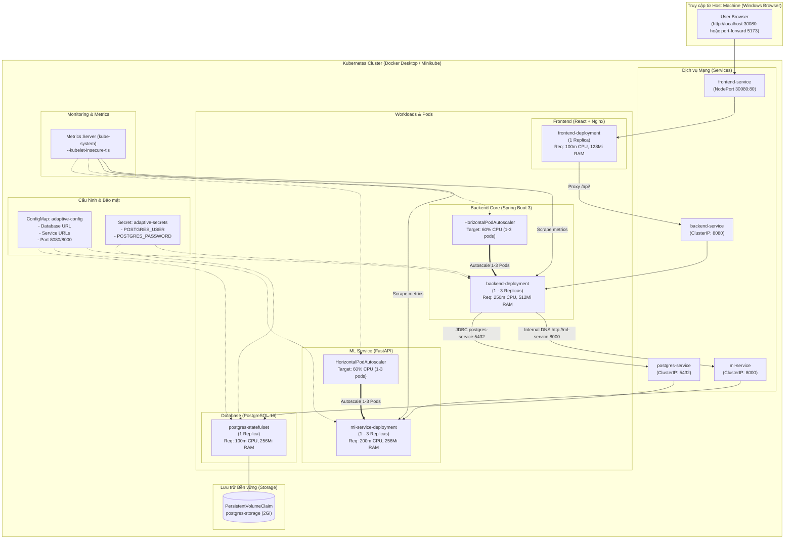

# HƯỚNG DẪN TRIỂN KHAI HỆ THỐNG LÊN KUBERNETES & HPA AUTOSCALING
## Hệ Thống Gợi Ý Lộ Trình Học Tập & Phân Loại Trình Độ Sinh Viên (Adaptive Learning System)

> **Tác giả:** Kubernetes & Cloud Native DevOps Team  
> **Phiên bản:** 1.0.0  
> **Môi trường mục tiêu:** Docker Desktop Kubernetes / Minikube trên Windows 11  
> **Tập tin cấu hình:** Thư mục `deployment/k8s/`

---

## 1. TỔNG QUAN KIẾN TRÚC CLOUD-NATIVE TRÊN KUBERNETES

Toàn bộ hệ thống được container hóa và điều phối (orchestrated) trên Kubernetes theo mô hình microservices:



---

## 2. BẢNG THÔNG SỐ TÀI NGUYÊN & PROBES (RESOURCE LIMITS & HEALTHCHECKS)

| Đối tượng | Loại K8s | CPU Request | CPU Limit | RAM Request | RAM Limit | Liveness Probe | Readiness Probe |
| :--- | :--- | :--- | :--- | :--- | :--- | :--- | :--- |
| **frontend** | Deployment | `100m` | `300m` | `128Mi` | `256Mi` | HTTP GET `/` (80) | HTTP GET `/` (80) |
| **backend** | Deployment | `250m` | `1000m` | `512Mi` | `1Gi` | HTTP GET `/api/health` (8080) | HTTP GET `/api/health` (8080) |
| **ml-service** | Deployment | `200m` | `800m` | `256Mi` | `1Gi` | HTTP GET `/health` (8000) | HTTP GET `/health` (8000) |
| **postgres** | StatefulSet | `100m` | `500m` | `256Mi` | `512Mi` | `pg_isready` (5432) | `pg_isready` (5432) |

---

## 3. CHUẨN BỊ MÔI TRƯỜNG KUBERNETES LOCAL

Hệ thống hỗ trợ 2 môi trường local phổ biến nhất trên Windows:

### Lựa chọn A: Sử dụng Docker Desktop Kubernetes (Khuyên dùng)
1. Mở giao diện **Docker Desktop** trên Windows.
2. Vào biểu tượng bánh răng **Settings** $\rightarrow$ chọn thẻ **Kubernetes**.
3. Tích chọn **Enable Kubernetes** $\rightarrow$ nhấn **Apply & restart**.
4. Chờ 2-3 phút đến khi icon Kubernetes ở góc dưới chuyển sang màu xanh lá cây (`Kubernetes running`).
5. Kiểm tra kết nối:
   ```powershell
   kubectl get nodes
   ```

### Lựa chọn B: Sử dụng Minikube
Nếu sử dụng Minikube:
```powershell
# Khởi động cluster với driver docker
minikube start --driver=docker --cpus=4 --memory=6144

# Nạp trực tiếp image từ docker daemon vào minikube (không cần push internet)
minikube image load adaptive-learning-system-frontend:latest
minikube image load adaptive-learning-system-backend:latest
minikube image load adaptive-learning-system-ml-service:latest
```

---

## 4. BẮT BUỘC: CÀI ĐẶT METRICS SERVER ĐỂ HPA HOẠT ĐỘNG

> [!IMPORTANT]
> **Nguyên tắc kỹ thuật cốt lõi về HPA:**
> Horizontal Pod Autoscaler (HPA) **bắt buộc phải có Metrics Server** để thu thập CPU/Memory metrics từ Kubelet.
> - Nếu **không có** Metrics Server: `kubectl get hpa` sẽ luôn hiển thị `<unknown>/60%`, và cluster **không thể** tự động scale.
> - Trên môi trường local (Docker Desktop / Minikube), chứng chỉ Kubelet là tự ký (self-signed cert), do đó Metrics Server **bắt buộc phải chạy với cờ `--kubelet-insecure-tls`**.

Tập tin [deployment/k8s/metrics-server.yaml](deployment/k8s/metrics-server.yaml) đã được cấu hình sẵn cờ `--kubelet-insecure-tls`. Cài đặt bằng một lệnh:

```powershell
kubectl apply -f deployment/k8s/metrics-server.yaml
```

Kiểm tra Metrics Server hoạt động:
```powershell
# Chờ pod metrics-server chuyển sang Running
kubectl get pods -n kube-system -l k8s-app=metrics-server

# Kiểm tra lệnh top hoạt động (mất khoảng 15-30 giây để bắt đầu có số liệu đầu tiên)
kubectl top nodes
kubectl top pods
```

---

## 5. QUY TRÌNH TRIỂN KHAI TOÀN BỘ HỆ THỐNG

### Cách 1: Sử dụng Script tự động `deploy_k8s.ps1`
```powershell
powershell -ExecutionPolicy Bypass -File .\deployment\k8s\deploy_k8s.ps1 -Action apply
```

### Cách 2: Triển khai thủ công bằng lệnh `kubectl`

#### Bước 1: Tạo Secret (Bảo mật credentials)
```powershell
kubectl apply -f deployment/k8s/secret.yaml.example
```
*(Hoặc tạo trực tiếp không qua file: `kubectl create secret generic adaptive-secrets --from-literal=POSTGRES_USER=adaptive_user --from-literal=POSTGRES_PASSWORD=adaptive_password_dev`)*

#### Bước 2: Áp dụng toàn bộ Manifests bằng Kustomize
```powershell
kubectl apply -k deployment/k8s
```

#### Bước 3: Kiểm tra trạng thái khởi động Pods
```powershell
kubectl get pods -o wide -w
```
Kết quả mong đợi:
```text
NAME                                     READY   STATUS    RESTARTS   AGE
postgres-statefulset-0                   1/1     Running   0          45s
ml-service-deployment-xxxxxxxxx-xxxxx    1/1     Running   0          40s
backend-deployment-xxxxxxxxx-xxxxx       1/1     Running   0          35s
frontend-deployment-xxxxxxxxx-xxxxx      1/1     Running   0          30s
```

#### Bước 4: Kiểm tra Services và HPA
```powershell
kubectl get services
kubectl get hpa
```
Kết quả HPA khi Metrics Server đã scrape số liệu:
```text
NAME             REFERENCE                          TARGETS   MINPODS   MAXPODS   REPLICAS   AGE
backend-hpa      Deployment/backend-deployment      2%/60%    1         3         1          2m
ml-service-hpa   Deployment/ml-service-deployment   1%/60%    1         3         1          2m
```

---

## 6. TRUY CẬP ỨNG DỤNG TỪ TRÌNH DUYỆT

- **Cách 1 (NodePort):** Truy cập trực tiếp qua cổng [http://localhost:30080](http://localhost:30080)
- **Cách 2 (Port-Forwarding):**
  ```powershell
  # Mở cổng Frontend
  kubectl port-forward svc/frontend-service 5173:80
  
  # Mở cổng Backend API
  kubectl port-forward svc/backend-service 8080:8080
  ```
  Truy cập giao diện Web Portal tại: [http://localhost:5173](http://localhost:5173).

---

## 7. KỊCH BẢN TẠO TẢI THỬ NGHIỆM VÀ DEMO AUTO-SCALING (HPA)

Kịch bản chứng minh khả năng tự co giãn (Elastic Scaling) khi tải tăng đột biến:

### Bước 1: Quan sát trạng thái ban đầu (1 Pod)
Mở cửa sổ PowerShell thứ nhất và theo dõi HPA thời gian thực:
```powershell
kubectl get hpa -w
```

### Bước 2: Bắn tải liên tục bằng `load-generator`
Mở cửa sổ PowerShell thứ hai và khởi chạy pod tạo tải:
```powershell
kubectl apply -f deployment/k8s/load-generator.yaml
```
Pod `load-generator` sử dụng 2 replicas liên tục gửi HTTP GET requests tới `backend-service:8080/api/health` và `ml-service:8000/health`.

### Bước 3: Quan sát HPA tự động Scale Up lên 2 và 3 Pods
Tại cửa sổ theo dõi `kubectl get hpa -w`, bạn sẽ thấy:
1. Chỉ số CPU tăng vọt: `TARGETS: 78%/60%` rồi `95%/60%`.
2. HPA phát hiện CPU vượt ngưỡng 60%, tự động điều chỉnh: `REPLICAS: 1 -> 2 -> 3`.
3. Kiểm tra danh sách pods:
   ```powershell
   kubectl get pods -l app=backend
   ```
   Sẽ thấy 3 pods backend đồng thời xử lý tải!

### Bước 4: Ngắt tải và quan sát Scale Down
Dừng pod tạo tải:
```powershell
kubectl delete -f deployment/k8s/load-generator.yaml
```
1. Mức sử dụng CPU giảm về `1%/60%`.
2. Sau thời gian ổn định `stabilizationWindowSeconds: 60s`, HPA tự động thu gọn số lượng pods về mức tối thiểu `minReplicas: 1`.

---

## 8. DỌN DẸP TÀI NGUYÊN (CLEANUP)

```powershell
# Xóa toàn bộ ứng dụng trên Kubernetes
kubectl delete -k deployment/k8s

# Hoặc dùng script:
powershell -ExecutionPolicy Bypass -File .\deployment\k8s\deploy_k8s.ps1 -Action delete
```

